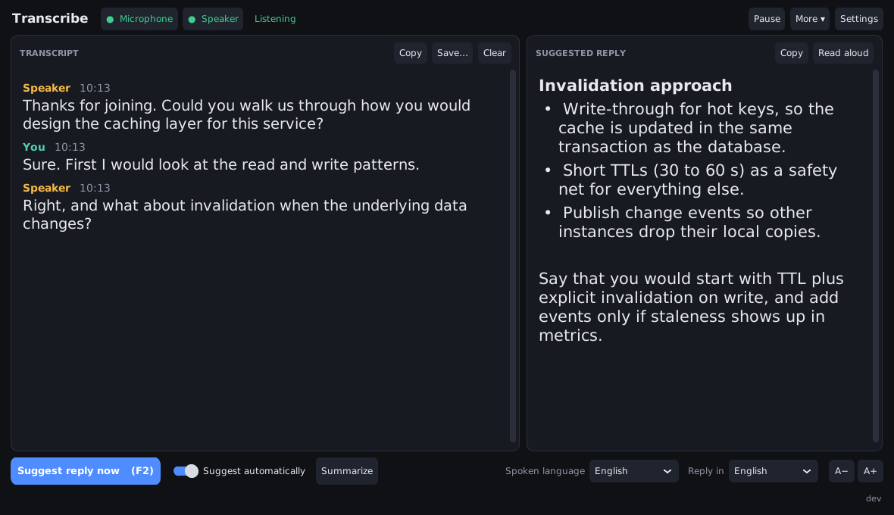

# Transcribe

A Windows program that writes down a live conversation as it happens, and suggests what to say next.

- **Transcript**: what you say (microphone) and what the others say (the sound of your computer: a
  meeting, a call, a video) appear as text within seconds, in two colours.
- **Suggested reply**: an AI model reads the conversation and proposes your next answer, automatically
  or when you press **F2**.
- **Summary** of the conversation at any moment.



## Download and start

1. Open [Releases](https://github.com/samaliyan/transcribe/releases) and download
   `Transcribe-<version>-windows.zip` (Windows 10/11, 64-bit).
2. Unzip it anywhere and double-click `Transcribe.exe`. Nothing else has to be installed.
3. Transcription starts at once and needs no internet: the speech to text model is inside the package.
4. For suggested replies: **Settings › AI replies**, enter the API key of your AI provider, press
   **Test the connection**, then **Save**.

To update, unzip the new version and copy your `override.yaml` (your settings) into the new folder.

## Using it

| | |
|---|---|
| **F2** or **Ctrl+Enter** | Suggest a reply now |
| **F3** | Automatic suggestions on / off |
| **F4** | Pause / resume transcription |
| **Ctrl+S** | Save the transcript |
| **Ctrl+,** | Settings |
| **Ctrl + / Ctrl −** | Larger / smaller text |

- **Microphone / Speaker** (top left) switch each source on and off. They also show when no device was found.
- **Spoken language** is the language people speak; **Reply in** is the language of the suggestions.
- Click a line of the transcript to see the reply that was suggested at that point; right-click for
  *Reply to the selected text* and *Edit this line*.
- **More › Keep the window on top** keeps the window visible next to a meeting.
- The transcript of every session is saved when the program closes
  (**More › Open the folder with transcripts and logs**).
- If something cannot work (no internet, a rejected key, a missing device), the window says what and why.

## Settings

**AI replies.** Any OpenAI-compatible provider works: enter its key, its address (*Base URL*) and the model
name exactly as the provider writes it. If the provider is not reachable from your network, a VPN or a
proxy (**Settings › General**) is needed; transcription on this computer keeps working without either.

**Speech to text.**

| Engine | Cost | Notes |
|---|---|---|
| On this computer (default) | free | Private and offline. Model `base` comes with the program; `small` is more accurate and needs a good CPU; larger ones need a GPU. Other models are downloaded once. |
| OpenAI API | paid | Much more accurate, above all for languages other than English. Uses the same key and Base URL as the replies. |
| OpenAI Realtime | paid | Streaming; see [docs/OpenAIRealtime.md](docs/OpenAIRealtime.md). |
| Deepgram | paid | Needs a Deepgram key. |

For Persian and other non-English conversations the small local models make many mistakes: use an online
engine (or a GPU with a large model) when the result matters.

**Assistant.** Choose a role (meeting assistant, job interview, explaining, casual) and add facts about
yourself and the meeting to the instructions: the replies get much better with that context.

All settings are stored in `override.yaml` next to the program (the API key too, as plain text: do not
share that file). `parameters.yaml` lists every option with its default.

## فارسی (راهنمای کوتاه)

۱. از بخش [Releases](https://github.com/samaliyan/transcribe/releases) فایل `Transcribe-<version>-windows.zip`
را بگیرید، از حالت فشرده خارج کنید و `Transcribe.exe` را اجرا کنید.

۲. رونویسی بلافاصله و بدون اینترنت شروع می‌شود (صدای میکروفون = You، صدای خروجی کامپیوتر = Speaker).

۳. برای پیشنهاد پاسخ: **Settings › AI replies**، کلید API، آدرس سرویس (Base URL) و نام مدل را وارد کنید،
**Test the connection** را بزنید و بعد **Save**.

۴. برای گفت‌وگوی فارسی: «Spoken language» را روی Persian بگذارید. مدل‌های کوچکِ داخل برنامه برای فارسی
خطای زیادی دارند؛ برای کار مهم در **Settings › Speech to text** موتور «OpenAI API» را انتخاب کنید.

۵. **F2** هر لحظه پاسخ پیشنهادی می‌گیرد، **F4** رونویسی را متوقف/ادامه می‌دهد، و متن هر جلسه هنگام بستن
برنامه خودکار ذخیره می‌شود.

## Running from the source code

```bash
git clone https://github.com/samaliyan/transcribe
```

Then, on Windows with Python 3.11 or 3.12, run `setup.bat` once and start the program with:

```bash
cd app\transcribe
```

```bash
python main.py
```

`python main.py --help` lists the command line options (transcribing an audio file with `-t`, choosing
devices, and so on). The unit tests run with `python -m pytest tests -q` in `app\transcribe`.

More detail on single subjects is in [docs](docs): [providers](docs/Providers.md),
[audio devices](docs/AudioCustomization.md), [batch use](docs/BatchOperations.md),
[configuration files](docs/AppConfig.md), [developer guide](docs/DeveloperGuide.md). Some of those pages
still show the window of earlier versions.

## New versions (maintainers)

Every merge into `main` that changes the program builds the Windows package, tests it on Windows (the
window opens and closes, start-up time, a real transcription of a sample file) and publishes the next
version by itself (2.0.1 after 2.0.0). Changes to documentation only publish nothing. For a bigger step
(2.1.0, 3.0.0), write the number in `build/next-version.txt` in that merge.

## Credits and license

This is a fork of [vivekuppal/transcribe](https://github.com/vivekuppal/transcribe) (itself based on
[ecoute](https://github.com/SevaSk/ecoute)), with a rebuilt live audio pipeline and a new window.
MIT license, see [LICENSE](LICENSE).
